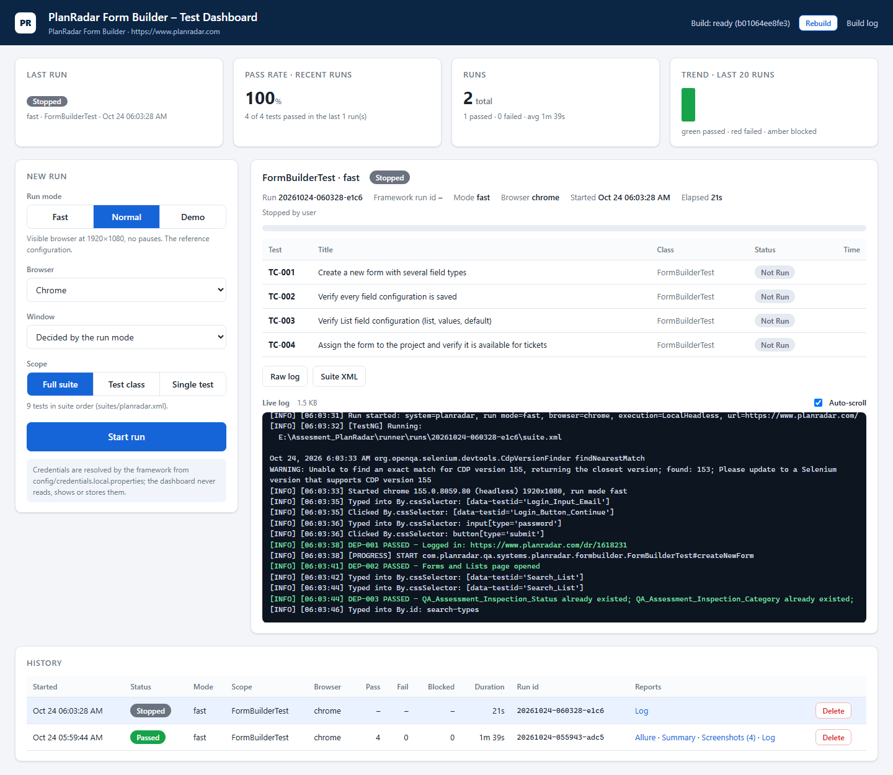

# PlanRadar QA Assessment – Form Builder

Manual test design and UI automation for the **PlanRadar form builder** (Forms and Lists › Forms).

| # | Deliverable | Where |
|---|---|---|
| 1 | Test plan, manual scenarios, test cases and expected results | [docs/01_Test_Plan.md](docs/01_Test_Plan.md), [docs/02_Test_Cases.md](docs/02_Test_Cases.md) |
| 2 | Automated tests – **scenario 1** (form creation & configuration) and **scenario 4** (mandatory fields) | `src/`, [docs/Automated_Test_Cases.md](docs/Automated_Test_Cases.md) |
| 3 | Recommendations for the form builder | [docs/03_Recommendations.md](docs/03_Recommendations.md) |
| – | Execution report and evidence of the last run | [docs/04_Test_Execution_Report.md](docs/04_Test_Execution_Report.md), [docs/evidence/](docs/evidence) |

## What is automated

| Scenario | Test cases | Class |
|---|---|---|
| 1 – Create a form with different field types and configure it | TC-001 create form · TC-002 field configuration · TC-003 List fields · TC-004 project assignment | `systems/planradar/formbuilder/FormBuilderTest` |
| 4 – Mandatory fields block saving a ticket | TC-005 text · TC-006 List · TC-007 valid save · TC-008 existing ticket · TC-009 project-level override | `systems/planradar/mandatory/MandatoryFieldsTest` |

Both scenarios run with the **administrator account only**. Scenario 2 (field permissions per role) needs additional role
accounts and scenario 3 (default values) was left to manual testing; both are fully specified in [docs/02_Test_Cases.md](docs/02_Test_Cases.md).

Every run builds its own form `QA_Assessment_Form_<run id>` with seven custom fields (Short Text, Long Text, Date,
Decimal, two List fields, Checkbox; two of them mandatory, five with a default value), assigns it to the project
`QA Assessment - Form Builder` and creates uniquely named tickets. Nothing that existed before a run is modified or
deleted; the one shared setting TC-009 changes (a per-project *Mandatory* flag) is restored in `finally`.

## Stack

Java 21 · Maven · Selenium 4.49 (Selenium Manager resolves the browser driver) · TestNG 7.12 · Allure 2.29 · log4j2 ·
Python 3.10+ (suite generation and the test dashboard, standard library only).
Page Object + Flow + Builder, explicit waits only (no `Thread.sleep`), locators on PlanRadar's own `data-testid`s.

The project follows a multi-system layout: a **shared core** (browser, waits, actions, configuration, logging,
screenshots, assertions, reporting lifecycle) that knows nothing about PlanRadar, and one **system adapter** per
application under `systems/<key>` (configuration, pages, flows, fixtures, test data, report content). PlanRadar is
the registered system; another application is added as a sibling `systems/<key>` package with its own profile,
test data, suite and dashboard entry (`runner/environments.json`).

```
src/main/java/com/planradar/qa
├── core                              shared, application-independent
│   ├── drivers       DriverFactory (Chrome / Edge / Firefox; Local, LocalHeadless, Remote Grid; 1920×1080), WebDriverProvider
│   ├── listeners     TestNGListeners (screenshots, Allure, run context, diagnostics), SystemReportingHooks, TestOutcome
│   ├── media         ScreenshotsManager
│   ├── utils         OutputPaths (per-run output root), WaitManager (waits.properties, polling wait)
│   │   ├── actions     ElementActions (retrying, synchronised interactions)
│   │   ├── dataReader  PropertyReader, SystemProfile, JsonReader, LocalCredentials
│   │   ├── logs        LogsManager
│   │   └── report      AllureEnvironmentManager (categories, environment), Covers, FailureClassification
│   └── validations   Checkpoints (hard asserts as steps), SoftAssertions
└── systems/planradar                 the PlanRadar adapter
    ├── config        PlanRadarConfig (systems/planradar.properties), PlanRadarCredentials
    ├── pages         LoginPage, FormsListPage, FormBuilderPage, FieldPropertiesPanel, ListsPage, ProjectPage,
    │                 TicketsPage, TicketDialog, components/{ReactSelect, DatePicker}
    ├── flows         AuthenticationFlow, FormSetupFlow, TicketFlow      (business steps, Allure @Step)
    ├── fixtures      AssessmentFixture + Dependency                      (DEP-001…008, resolved once per run)
    ├── testdata      FormDefinition / FieldDefinition / ListDefinition / TicketData builders, AssessmentData, TestRun
    └── reporting     PlanRadarReportingHooks, ExecutionSummary, Attachments
src/main/resources
├── environment.properties  active.system=planradar        webapp.properties  browser, executionType, Grid
├── waits.properties        explicit / page-load timeouts   log4j2.properties, allure.properties
├── systems/planradar.properties                            PlanRadar URL, project, ticket location, artifact prefix
└── META-INF/services       TestNG listener + PlanRadar reporting hooks
src/test/java/com/planradar/qa/systems/planradar
├── PlanRadarBaseTest             fresh browser + verified login per test method
├── formbuilder/FormBuilderTest   TC-001 … TC-004
└── mandatory/MandatoryFieldsTest TC-005 … TC-009
src/test/resources/test-data/planradar/login-data.json   role "admin" (no secrets; see Setup)
suites/planradar.xml              the suite (generated)
tools/                            systems.py (system catalog), testsource.py, regression.py, gen_suites.py,
                                  gen_test_catalog.py, allure_report.py
runner/                           server.py + static/index.html (test dashboard), environments.json
docs/test-catalog/planradar.md    test catalog (generated)
```

## Setup (one time)

Requires JDK 21, Maven 3.9+ and Chrome (or Edge / Firefox).

1. **Credentials** never go into the repository. Copy the example and fill in the administrator account
   (the file is git-ignored):
   ```bash
   cp config/credentials.example.properties config/credentials.local.properties
   ```
   `PLANRADAR_EMAIL` / `PLANRADAR_PASSWORD` can also be given as environment variables or `-D` properties;
   `-Ddata.planradar.login-data.admin.email` / `.password` override them for a single run.
   `src/test/resources/test-data/planradar/login-data.json` only declares the role and never holds values.
2. **Target data** in `src/main/resources/systems/planradar.properties`: the existing project (`planradar.project.name`)
   and the folder/plan used as ticket Location (`planradar.ticket.location`). Any key can be overridden with `-D`.

## Run

```bash
mvn test                                   # whole suite (suites/planradar.xml), Chrome, visible (run.mode=normal)
mvn test -Drun.mode=fast                   # CI style, headless (same browser as -Dheadless=true)
mvn test -Drun.mode=demo                   # visible, maximized, highlighted and slowed down for an audience
mvn test -Dbrowser=edge                    # or firefox
mvn test -Dtest=MandatoryFieldsTest        # one class (its setup is resolved by the fixture)
mvn test "-Dsurefire.suiteXmlFiles=suites/planradar.xml" "-Dactive.system=planradar"   # explicit system suite
mvn test -DexecutionType=Remote -DremoteHost=<grid host> -DremotePort=4444             # Selenium Grid
```

### Run modes

One switch, `-Drun.mode=demo|normal|fast` (default `normal`, file default in `environment.properties`), selects a
profile. A mode only supplies defaults: an explicit `-Dheadless`, `-DexecutionType`, `-Dbrowser` or wait key still
wins. Explicit waits, including PlanRadar's own (List default settling, ticket search settling), are identical in
every mode.

| Mode | Browser | Pause after each action | Element highlight | Typical use | Command |
|---|---|---|---|---|---|
| `normal` | visible, 1920×1080 | none | no | local development, the reference configuration | `mvn test` |
| `fast` | headless, 1920×1080 | none | no | CI, quick regression | `mvn test -Drun.mode=fast` |
| `demo` | visible, maximized (1920×1080 if the screen is narrower than 1280 px) | `demo.step.delay.ms` (800 ms) | red outline (`demo.highlight=true`) | showing the suite to an audience | `mvn test -Drun.mode=demo` |

The demo pause is applied in one place (`ElementActions`, after a click / type / select / hover has completed) and is
a no-op in the other modes; it is presentation only and never replaces synchronisation. Tune it with e.g.
`-Ddemo.step.delay.ms=1500` or `-Ddemo.highlight=false`. The active mode is logged at run start and shown in the
Allure environment (`Run.mode`), in every test's run context and in `execution-summary.md`. The test dashboard has
the same choice. In PowerShell, quote properties that contain a dot: `mvn test "-Drun.mode=demo"`.

After adding or renaming test classes, regenerate the suite and the catalog (both are reproducible from the sources):

```bash
python tools/gen_suites.py                 # suites/<system>.xml
python tools/gen_test_catalog.py           # docs/test-catalog/<system>.md
```

### Test dashboard

```bash
python runner/server.py                    # http://127.0.0.1:8090
python runner/server.py --port 9000 --open # other port, open the browser
python runner/server.py --stop             # stop it (and any run it is executing)
```



*PlanRadar Form Builder – Test Dashboard* is a single page with no build step and no external resources, so it
works offline. Python standard library only.

- **New run:** pick the run mode (fast / normal / demo; demo also takes the pause and highlight), the browser
  (Chrome / Edge / Firefox), an optional headless or visible override, and the scope. The scope is the full suite,
  one test class or a single test, listed by TC id and title from the test sources.
- **Live run:** status, elapsed time, a progress bar, one row per test (pending → running → passed / failed /
  blocked) and the streaming log with auto-scroll. **Stop** kills the whole Java → driver → browser process tree
  (`taskkill /T` on Windows).
- **History:** every run with mode, scope, browser, pass / fail / blocked counts, duration and id, with links to that
  run's Allure report, the rendered `execution-summary.md`, a screenshot gallery and the raw log. A run can be
  deleted.
- **Overview cards:** the last result, the pass rate over the last 10 runs, run totals and a trend of the last 20
  runs.

The dashboard compiles a snapshot of the sources into `runner/.build/<id>` and starts TestNG from it with an argument
list (no shell), so `-Dkey.with.dots` is never split by PowerShell. Every run gets its own folder
`runner/runs/<id>/`: `run.json`, `console.log`, `suite.xml`, `output/` (screenshots, Allure results, execution
summary) and a single-file `allure-report/`. Both `-Doutput.dir` and `-Dallure.results.directory` point there, so a
dashboard run never touches `target/` or the main `allure-report/`. Both folders are git-ignored.

**Security:**
- One run at a time: a second start is rejected with a clear message.
- Requests accept only whitelisted fields, test classes and methods. Credentials or custom properties are refused.
  The framework resolves the login itself; the page shows only where it comes from, never the value.
- Log text is escaped. Only files inside the run's folder are served (`run.json` excluded).
- The server listens on `127.0.0.1` only and checks the `Host` header. Writes need an `X-Dashboard` header.

A separately launched `mvn test` on the same tenant is not coordinated with the dashboard.

Every test logs in through the UI, resolves the setup it needs (`DEP-001…008`) and ends its session. A setup step
that fails marks every dependent test **BLOCKED** (classification `DEPENDENCY_FAILURE`) instead of failing it.

## Results and evidence

Paths below are for a Maven run; every location derives from `-Doutput.dir` (default `target`), which the test dashboard
sets to `runner/runs/<id>/output` (together with `-Dallure.results.directory`).

| What | Where |
|---|---|
| Summary of the run: dependencies, every test case with status and triage classification | `target/execution-summary.md` |
| Screenshot at the end of every test, named `<TC id>_<status>` | `target/screenshots/` |
| Allure raw results – steps, screenshots, failure context | `target/allure-results/` |
| Allure HTML report: `mvn allure:report` (no Allure install needed), or `python tools/allure_report.py` to generate it (keeping the trend history) and open it on http://localhost:8080 | `allure-report/` |

What the Allure report contains for every test: scenario / story / severity / owner, a description (objective,
preconditions, expected result), the manual test cases it covers as tags (`TC-FB-…`, `TC-MAN-…`), every UI action
as a step, **every verification as a step with its Expected and Actual value**, the test data entered (form
definition, ticket values), a run-context attachment (run id, form, project, browser version, final URL) and the
final screenshot. Failures additionally get the page HTML and the browser console, and are grouped in *Categories*
by triage class (dependency failure, suspected product defect, automation defect, environment, configuration).
| TestNG / Surefire reports | `target/surefire-reports/` |
| Log (no secrets, no typed values) | `target/logs/run.log` |

Last recorded run (`mvn -B test -Dheadless=true`, Chrome 155, 24 Oct 2026): **9 / 9 passed** in 248 s – see
[docs/04_Test_Execution_Report.md](docs/04_Test_Execution_Report.md) and
[docs/evidence/run-20261024_052112_execution-summary.md](docs/evidence/run-20261024_052112_execution-summary.md).

## Design notes

- **Independent tests, explicit dependencies.** Each test starts in its own browser and asks the fixture for what it
  needs; the first test that needs a dependency resolves it, later ones reuse the result. Test order is a convenience,
  not a requirement.
- **Builders validate the test data** before a browser starts (a default on a type without defaults, a List field
  without a list, a list default that is not a list value → immediate failure with a clear message).
- **Observable outcomes only.** Assertions check what a user sees: a form listed and reopened, a `*` marker, a
  validation message next to the field, a ticket listed and reopened with its values. Dates are compared as ISO
  (`data-datevalue`) and decimals as numbers, never as locale-formatted text.
- **Security.** No credentials in the repository or in reports; a login failure produces a screenshot and a reason,
  never the password; CAPTCHA / MFA are reported as blockers and never bypassed.

## Known limitations

- TC-009 changes a shared per-project setting and restores it; do not run the suite in parallel with manual work on
  the same project.
- The demo tenant is shared, so forms and tickets created by earlier runs remain visible (each carries its run id).
- PlanRadar's ticket search matches every word against several columns (the project name included) and the list is
  paginated at 20 rows, so tickets are located by their unique run suffix (`<runId>-<n>`) and then matched by exact
  title (see finding F9 in `docs/03_Recommendations.md`).
